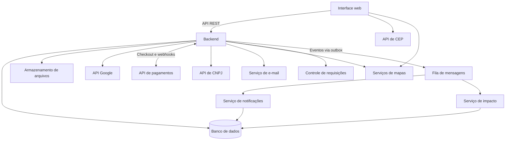
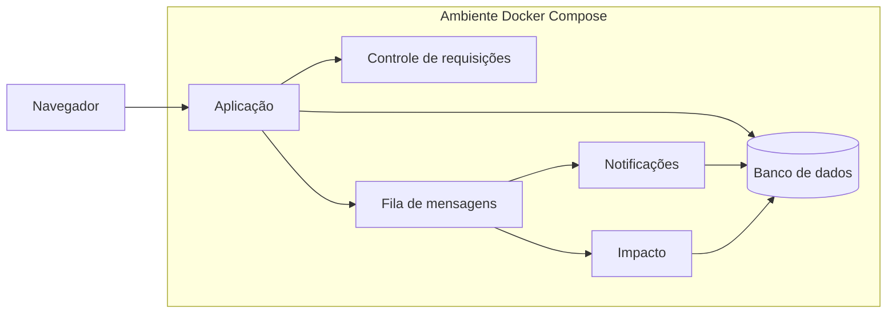
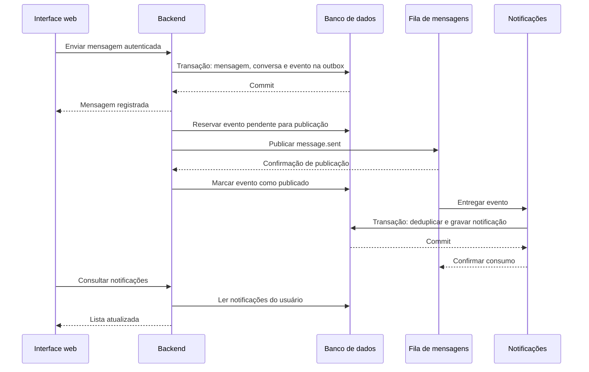

# Arquitetura do ReUsa+

[Documentação técnica](documentacao-tecnica.md) · [Banco de dados](banco-de-dados.md) · [API](api.md)

## 1. Escopo e visão geral

O ReUsa+ combina uma aplicação web com uma API central e serviços de apoio que
podem executar em processos e contêineres separados. A organização atual é uma
aplicação principal modular, complementada por processamento distribuído de
eventos. Os módulos de anúncios, negociação e administração não são
microsserviços independentes.

A interface React executa no navegador. O backend Node.js/Express concentra
autenticação, autorização, regras de negócio, persistência e integrações que
exigem credenciais. PostgreSQL é a fonte de verdade em produção; fotos e vídeos
podem ficar no Cloudflare R2. RabbitMQ transporta eventos para os serviços de
notificações e impacto. Redis oferece limitação compartilhada de requisições.

Este documento descreve a implementação do repositório. A presença de um serviço
no Docker Compose não comprova que ele esteja ativo no ambiente público.

## 2. Diagrama de componentes

Os nomes do diagrama representam responsabilidades; as tecnologias aparecem no
texto e nas tabelas seguintes.



| Componente | Implementação e responsabilidade |
| --- | --- |
| Interface web | React 18, React Router, Zustand e Vite; telas, formulários, estado da sessão e apresentação dos dados. |
| Backend | Node.js 22 e Express; API REST, validação, autorização, transações, tarefas periódicas e integração com serviços externos. |
| Banco de dados | PostgreSQL no modo de produção; SQLite/SQL.js como alternativa local e de testes. |
| Armazenamento | Cloudflare R2 ou provedor compatível com S3; diretório local quando não configurado. |
| Controle de requisições | Redis quando configurado; limitação em memória no modo local. |
| Fila de mensagens | RabbitMQ, exchange de eventos e filas duráveis dos consumidores. |
| Notificações | Consome eventos e persiste os avisos derivados. Não é o serviço de e-mail SMTP. |
| Impacto | Consome conclusão de negociações e atualiza indicadores derivados de reaproveitamento. |

## 3. Organização do código

```text
Reusa-/
├── src/
│   ├── main.jsx                  # Inicialização React e BrowserRouter
│   ├── App.jsx                   # Entrada da aplicação
│   ├── routes.jsx                # Telas e navegação
│   ├── components/               # Componentes dos fluxos da plataforma
│   ├── state/store.js            # Estado global e ações com Zustand
│   └── services/                 # Cliente HTTP e estado da conexão Stripe
├── backend.js                    # Inicialização da API e modo SQLite
├── storage/
│   ├── postgres-api.js           # Rotas dos domínios no modo PostgreSQL
│   ├── postgres-repository.js    # Pool, consultas e transações PostgreSQL
│   ├── postgres-domains.js       # Repositórios de usuários e anúncios
│   ├── campaign-api.js           # Campanhas e contribuições
│   ├── community-api.js          # Alertas, pedidos, perguntas e transporte
│   ├── delivery-api.js           # Acordos, recebimento e acompanhamento
│   ├── stripe-api.js             # Contas, pagamentos, inbox e conciliação
│   └── post-media*.js            # Contrato e validação de mídias
├── distributed/                  # Publicação AMQP, R2, Redis e métricas
├── services/                     # Consumidores e cliente Stripe
├── migrations/                   # Evolução do esquema PostgreSQL
├── scripts/                      # Aplicação, migração e verificação do banco
├── test/                         # Suítes e fluxos automatizados
├── Dockerfile                    # Imagem compartilhada pelos serviços Node
├── docker-compose.yml            # Ambiente distribuído de referência
└── railway.toml                  # Build e inicialização na Railway
```

### Interface e comunicação HTTP

`src/main.jsx` monta o React com `BrowserRouter`. `src/routes.jsx` organiza as
telas; componentes de campanhas, mídia, negociação, entrega e conexão Stripe
encapsulam partes desses fluxos. O Zustand mantém sessão, anúncios, conversas,
notificações, favoritos e ações de atualização do estado.

`src/services/api.js` centraliza requisições para `/api`, adiciona o JWT ao
cabeçalho `Authorization` e transforma erros HTTP em mensagens com identificador
de correlação quando disponível. O token é armazenado no `localStorage` do
navegador. Uploads usam `FormData`; as demais operações normalmente usam JSON.

A atualização de conversas, notificações e negociações utiliza consultas HTTP
periódicas em intervalos definidos por tela. Não há WebSocket ou servidor de
eventos push implementado para esses fluxos. As notificações nativas do navegador
dependem de permissão e da aplicação aberta.

### Backend e seleção da persistência

`backend.js` prepara dependências, diretórios, middlewares, rotas e tarefas
periódicas antes de iniciar o servidor HTTP. No modo PostgreSQL, instancia o
repositório, verifica a conexão e aplica migrações antes de registrar as rotas.
`storage/postgres-api.js` atende os domínios migrados; módulos compartilhados
registram campanhas, comunidade, entrega e pagamentos para os dois bancos.

`PostgresRepository` oferece consultas parametrizadas, pool e transações com
`BEGIN`, `COMMIT` e `ROLLBACK`. A configuração `DATABASE_PROVIDER=postgres` exige
uma conexão em `POSTGRES_URL` ou `DATABASE_URL`. Com `NODE_ENV=production`, a
inicialização recusa a ausência dessa configuração. O SQLite não serve de réplica
ou espelho do PostgreSQL.

A camada histórica de rotas em `backend.js` continua registrada após as rotas
PostgreSQL. Isso não estabelece paridade automática entre os bancos: algumas
rotas auxiliares antigas ainda dependem de funções SQLite e não funcionam
corretamente no modo PostgreSQL. O catálogo da [API](api.md) distingue esses
casos; a documentação de um endpoint não deve ser interpretada como validação
de todos os seus modos de execução.

## 4. Implantação e limites dos processos

O Docker Compose define seis serviços. Os três serviços Node utilizam a mesma
definição de imagem, com comandos e variáveis diferentes.

| Serviço | Processo ou imagem | Porta no serviço | Persistência |
| --- | --- | --- | --- |
| `core` | `node backend.js` | `3000`, publicada no host | PostgreSQL; volume local `/data` para arquivos locais. |
| `postgres` | `postgres:16-alpine` | `5432`, interna | Volume `postgres-data`. |
| `rabbitmq` | `rabbitmq:3.13-management` | AMQP `5672`, interna | Volume `rabbitmq-data`. |
| `redis` | `redis:7-alpine` | `6379`, interna | Volume `redis-data`, com AOF configurado. |
| `notifications` | `node services/notification-service.js` | `3001`, interna | Tabelas próprias no PostgreSQL; volume `/data` disponível. |
| `impact` | `node services/impact-service.js` | `3002`, interna | Tabelas próprias no PostgreSQL; volume `/data` disponível. |

Os consumidores têm propriedade lógica de suas tabelas, mas a configuração
Compose usa a mesma instância e o mesmo banco PostgreSQL do núcleo. Portanto,
não há um banco físico independente para cada serviço nessa configuração.



Na Railway, `railway.toml` usa Railpack, executa `npm run build`, inicia com
`npm start` e verifica `/api/health`. Esse arquivo não cria automaticamente
PostgreSQL, Redis, RabbitMQ ou os consumidores. A disponibilidade desses serviços
e seus endereços dependem da implantação realizada na plataforma.

Detalhes de execução, variáveis e recuperação estão em [Operação](operacao.md).

## 5. Eventos, outbox e consistência

O identificador de um evento é estável durante suas tentativas. O envelope inclui
`id`, `type`, `occurredAt`, `correlationId` e `data`. O núcleo registra o evento em
`event_outbox` junto da alteração de negócio, evitando depender de uma chamada
AMQP bem-sucedida para preservar a intenção de publicação.

O publicador consulta a outbox ao iniciar, após operações que disparam a
publicação e em uma varredura a cada cinco segundos. No PostgreSQL, seleciona
lotes de até 100 registros com `FOR UPDATE SKIP LOCKED`, identifica a instância
em `locked_by` e usa um lease de um minuto. Falhas de publicação deixam o evento
pendente e agendam outra tentativa com atraso exponencial.

`distributed/event-publisher.js` utiliza um canal com confirmação do RabbitMQ,
exchange `topic` durável e mensagens persistentes. `published_at` é atualizado
após a confirmação de publicação. Essa confirmação não significa que um
consumidor já tenha processado o evento.

| Recurso | Comportamento implementado |
| --- | --- |
| Exchange principal | `reusa.events` por padrão; configurável por `EVENT_EXCHANGE`. |
| Fila de notificações | `reusa.notifications.v2`; assina `negotiation.*`, `message.sent` e `review.created`. |
| Fila de impacto | `reusa.impact.v2`; assina `negotiation.completed`. |
| Confirmação de consumo | `ack` após o processamento persistido com sucesso. |
| Deduplicação | Registro de `event_id` e atualização dos dados derivados na mesma transação. |
| Reconexão dos consumidores | Nova tentativa após aproximadamente três segundos quando o broker está indisponível. |
| Erro de processamento | `nack` sem reentrada na fila principal; encaminhamento para dead-letter exchange. |
| Mensagens mortas | Exchange `${EVENT_EXCHANGE}.dlx` e filas `*.dead`; exigem diagnóstico e eventual reprocessamento operacional. |

O modelo é de entrega **pelo menos uma vez**. Se o broker confirmar o evento e
o núcleo falhar antes de marcar a publicação, o evento pode ser reenviado; a
deduplicação dos consumidores evita repetir a alteração derivada. Não há
transação distribuída de duas fases nem garantia geral de execução exatamente
uma vez entre todos os sistemas.

Notificações e indicadores derivados podem aparecer depois da operação original:
isso é consistência eventual. As regras centrais de reserva e pagamento continuam
dependendo do estado transacional do banco, não desses indicadores.

Os consumidores precisam declarar suas filas e vínculos. A outbox publicada não
é uma verificação de que todas as filas necessárias já existiam. Outras rotinas,
como alertas de itens, lembretes e avisos de campanhas, também podem gravar
notificações diretamente no banco, sem passar pelos dois consumidores.

## 6. Sequência de uma mensagem privada



As consultas são representativas do modo PostgreSQL. Em caso de indisponibilidade
do broker, o envio já registrado permanece no banco e o evento aguarda a
publicação. O esquema não implica entrega instantânea ao navegador.

## 7. Pagamentos e integração assíncrona

O backend persiste tentativas de pagamento antes de criar o Checkout externo.
O comprador acessa a página hospedada pela Stripe; o retorno ao site não confirma
pagamento. Webhooks assinados entram em uma inbox persistente, e o backend
consulta os objetos atuais da Stripe para reconciliar conta, ambiente, valor,
moeda e estado financeiro.

Pagamentos e eventos pendentes são revisitados por uma rotina periódica no
processo principal. O cadastro Accounts v2 usa um destino próprio para eventos
thin; os eventos financeiros usam destinos snapshot. Esse mecanismo de inbox e
conciliação é diferente da outbox de eventos de domínio publicada no RabbitMQ.

Há separação entre teste e produção, cobrança direta em contas conectadas fora
da demonstração e operações de reembolso/contestação. A habilitação real de
vendedores e meios de pagamento permanece sob responsabilidade da Stripe.

Veja [Stripe em teste](stripe-testing.md) e [Stripe em produção](stripe-production.md).

## 8. Integrações externas

| Serviço | Função | Origem da chamada |
| --- | --- | --- |
| Google OAuth | Autenticação social e consulta de identidade. | Backend; navegador participa dos redirecionamentos. |
| Stripe | Onboarding de vendedores, Checkout, consulta e eventos financeiros. | Backend e páginas hospedadas pela Stripe. |
| Cloudflare R2 | Armazenamento de imagens e vídeos. | Upload no backend; leitura pública pelo navegador. |
| ViaCEP | Preenchimento de endereços. | Frontend. |
| BrasilAPI | Consulta cadastral de CNPJ. | Backend. |
| OpenStreetMap | Camadas visuais do mapa. | Frontend. |
| Nominatim | Geocodificação e busca de locais. | Frontend e backend. |
| Overpass | Busca de pontos públicos no OpenStreetMap. | Backend. |
| OSRM | Cálculo de rotas. | Backend. |
| SMTP | Confirmação de e-mail e recuperação de senha. | Backend, via Nodemailer. |

Google Fonts e URLs de imagens de exemplo são recursos estáticos. Geolocalização
e notificações nativas são recursos do navegador, não serviços próprios de
rastreamento ou Web Push.

## 9. Falhas e limites arquiteturais

- **PostgreSQL indisponível:** o núcleo não inicializa corretamente no modo de
  produção. O banco é uma dependência central; o Compose não configura réplica
  ou failover automático de PostgreSQL.
- **RabbitMQ indisponível:** eventos ainda não publicados permanecem na outbox.
  No modo PostgreSQL, remover o broker pode impedir avisos dependentes dos
  consumidores; não há equivalência geral com o modo local.
- **Consumidor indisponível:** a fila já declarada mantém mensagens conforme a
  configuração do broker; os dados derivados aguardam o consumo.
- **Redis ausente por configuração:** a limitação usa memória local. Essa
  alternativa não compartilha contadores entre réplicas nem os conserva após
  reinício. Redis configurado e inacessível afeta a inicialização/prontidão.
- **Serviço externo indisponível:** a operação correspondente pode falhar ou
  aguardar nova consulta, conforme seu módulo. Não há disponibilidade garantida
  para APIs públicas de mapas, CNPJ ou CEP.
- **R2 e arquivos locais:** objetos e banco de dados têm ciclos de vida distintos;
  uma imagem Docker não contém os objetos remotos ou os volumes de produção.
- **Escala horizontal:** há mecanismos de travas, leases e deduplicação para
  operações específicas, mas isso não constitui evidência de teste de carga,
  alta disponibilidade completa ou escala ilimitada.

O sistema não contrata transporte, não rastreia entregadores por GPS e não
implementa custódia financeira/escrow. Busca por foto e IA generativa não fazem
parte desta arquitetura. Não há Kubernetes, service mesh ou descoberta dinâmica
de serviços implementados no repositório.

## 10. Fontes e documentos relacionados

As decisões descritas podem ser conferidas em [backend.js](../backend.js),
[cliente HTTP](../src/services/api.js), [store](../src/state/store.js),
[rotas PostgreSQL](../storage/postgres-api.js),
[publicador](../distributed/event-publisher.js),
[serviço de notificações](../services/notification-service.js),
[serviço de impacto](../services/impact-service.js),
[persistência dos consumidores](../services/persistence.js),
[Docker Compose](../docker-compose.yml) e [Railway](../railway.toml).

Consulte também [Funcionalidades e regras](funcionalidades-e-regras.md),
[Banco de dados](banco-de-dados.md), [API](api.md), [Operação](operacao.md) e
[Segurança e testes](seguranca-e-testes.md).
