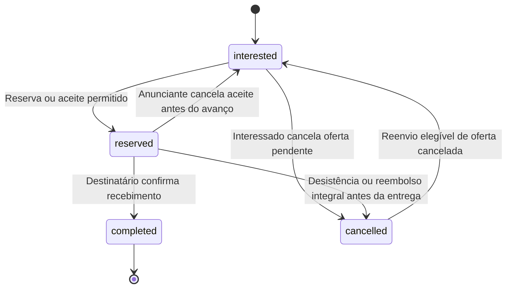

# Funcionalidades, requisitos e regras de negócio

[Documentação técnica](documentacao-tecnica.md) · [API](api.md) · [Banco de dados](banco-de-dados.md)

**Projeto:** ReUsa+  
**Autor:** Marcus Vinicius Campos da Silva  
**Referência:** implementação da versão `1.0.0`, base `051a07c`, revisada em 19/11/2026.

Este documento descreve o comportamento encontrado no código e nos testes. Os
identificadores `RF` e `RN` organizam a rastreabilidade da versão atual; não
representam funcionalidades futuras. Diferenças entre PostgreSQL e SQLite são
registradas explicitamente, pois a presença de uma tela não comprova que todos
os seus caminhos se comportem da mesma maneira nos dois modos.

## 1. Objetivo e escopo

O ReUsa+ conecta anunciantes e interessados em **doação, troca e venda** de
produtos. O escopo inclui publicação, descoberta, interação, negociação,
combinação da retirada ou entrega e confirmação de recebimento. Campanhas e
pedidos da comunidade organizam necessidades de materiais.

O sistema organiza o acordo entre pessoas. O transporte físico, a disponibilidade
de um ponto parceiro e a aprovação cadastral ou financeira pela Stripe não são
executados ou garantidos pelo ReUsa+.

## 2. Atores e permissões

| Ator | Responsabilidades e acesso |
| --- | --- |
| Visitante | Consulta conteúdos públicos, anúncios, campanhas, pontos de coleta e avaliações públicas. |
| Usuário autenticado | Gerencia seu perfil e anúncios, interage, envia mensagens e ofertas, cria pedidos e alertas e registra denúncias. |
| Anunciante | É proprietário do anúncio; decide propostas, administra a reserva, combina a entrega e, em vendas, conecta sua conta Stripe. |
| Interessado / destinatário | Demonstra interesse, envia a oferta monetária, paga quando aplicável e confirma o recebimento. |
| Organizador de campanha | Cria e encerra a campanha, responde a contribuições e confirma os materiais recebidos. |
| Contribuinte | Oferece quantidade e instruções privadas a uma campanha de outra pessoa e pode cancelar uma contribuição pendente. |
| Administrador | Consulta indicadores e usuários, suspende contas, exclui usuários quando permitido, modera anúncios e denúncias e administra pontos de coleta. |
| Stripe | É a fonte externa para cadastro do vendedor, capacidades de cobrança/repasse e resultados dos pagamentos, reembolsos e contestações. |

Os papéis de anunciante, interessado, organizador e contribuinte dependem do
recurso acessado, não de uma profissão ou categoria permanente de conta. Uma
conta de empresa não recebe automaticamente permissão administrativa.

**RN-01 — Identidade e autorização.** Rotas privadas verificam o token e a conta;
as ações também verificam propriedade ou participação. Uma conta suspensa é
recusada na autenticação das rotas protegidas.

**RN-02 — Privacidade da negociação.** Apenas os participantes acessam seu acordo,
endereço, pagamentos e imprevistos pelas rotas de negociação. O autor de um
anúncio consulta sua lista de interessados. Administradores usam rotas próprias
de moderação; não se deve presumir acesso irrestrito a toda conversa pelo perfil
administrativo.

## 3. Requisitos funcionais da versão

| ID | Requisito implementado | Fontes principais |
| --- | --- | --- |
| RF-01 | Cadastrar pessoa ou empresa e autenticar por e-mail/senha. | `backend.js`, `storage/postgres-api.js` |
| RF-02 | Verificar e-mail, reenviar confirmação e redefinir senha por link. | `backend.js`, `storage/postgres-api.js` |
| RF-03 | Autenticar pelo Google quando configurado. | `backend.js` |
| RF-04 | Editar perfil, avatar, senha e preferências de notificações. | `src/routes.jsx`, `storage/postgres-api.js` |
| RF-05 | Publicar, consultar, editar e excluir anúncios de doação, troca e venda. | `storage/postgres-api.js`, `backend.js` |
| RF-06 | Adicionar e ordenar fotos e vídeos, escolher capa e reproduzir vídeos. | `storage/post-media*.js`, `src/components/PostMedia*.jsx` |
| RF-07 | Registrar informações de retirada e região aproximada do anúncio. | `storage/community-api.js` |
| RF-08 | Buscar anúncios, filtrar por categoria/localidade e consultar proximidade. | `src/routes.jsx`, `storage/community-api.js` |
| RF-09 | Curtir, favoritar, comentar e fazer perguntas públicas sobre anúncios. | `storage/postgres-api.js`, `storage/community-api.js` |
| RF-10 | Criar alertas para novos anúncios compatíveis com uma busca. | `storage/community-api.js` |
| RF-11 | Iniciar conversa e interesse relacionados a um anúncio. | `storage/postgres-api.js` |
| RF-12 | Enviar, aceitar, recusar, cancelar e reenviar ofertas monetárias conforme a etapa. | `storage/postgres-api.js`, `storage/delivery-api.js` |
| RF-13 | Reservar um item e cancelar um aceite que ainda não avançou. | `storage/delivery-api.js`, `storage/postgres-api.js` |
| RF-14 | Reunir negociações enviadas/recebidas e destacar pendências do usuário. | `storage/delivery-api.js`, `src/components/NegotiationsPage.jsx` |
| RF-15 | Propor e aceitar local/horário de entrega ou retirada. | `storage/delivery-api.js` |
| RF-16 | Registrar saída para entrega e recebimento pelo destinatário. | `storage/delivery-api.js` |
| RF-17 | Emitir lembretes internos e registrar imprevistos da entrega. | `storage/delivery-api.js` |
| RF-18 | Conectar vendedores à Stripe e acompanhar pagamentos, reembolsos e contestações. | `storage/stripe-api.js`, `services/stripe-payments.js` |
| RF-19 | Registrar avaliações e consultar avaliações públicas, com as diferenças de modo descritas na seção 10. | `backend.js`, `storage/postgres-api.js` |
| RF-20 | Enviar mensagens, consultar conversas e limpar seu histórico visível. | `storage/postgres-api.js`, `src/state/store.js` |
| RF-21 | Criar campanhas, oferecer contribuições, responder e confirmar recebimentos. | `storage/campaign-api.js` |
| RF-22 | Criar pedidos da comunidade e oferecer anúncios próprios para doação. | `storage/community-api.js` |
| RF-23 | Consultar mapas, pontos de coleta, localização e rotas e sugerir pontos. | `backend.js`, `storage/collection-point-geocoding.js` |
| RF-24 | Bloquear interações e denunciar anúncios ou problemas de negociação. | `storage/community-api.js`, `storage/postgres-api.js` |
| RF-25 | Administrar usuários, anúncios, denúncias e pontos de coleta. | `storage/postgres-api.js`, `backend.js` |
| RF-26 | Apresentar notificações e indicadores de impacto derivados das operações. | `services/notification-service.js`, `services/impact-service.js` |

## 4. Conta, acesso e perfil

**RN-03 — Cadastro.** Nome, e-mail, senha e cidade são exigidos na criação. O
e-mail é normalizado e não pode ser duplicado; a senha possui mínimo de oito
caracteres. A interface oferece contas `person` e `business`; o cadastro
empresarial solicita razão social e CNPJ.

**RN-04 — Confirmação e recuperação.** O login por senha exige e-mail confirmado.
O link de verificação possui validade de 24 horas e o de redefinição de senha,
uma hora. Após redefinição válida, o token de recuperação é consumido e o e-mail
fica marcado como verificado. A resposta de solicitação de recuperação é
genérica para e-mails inexistentes ou inválidos; falha real no envio pode gerar
erro de serviço.

**RN-05 — Google.** O login social depende das credenciais e do callback do
ambiente. O backend troca o código de autorização e consulta a identidade no
Google. O mecanismo é diferente de verificar uma senha local.

**RN-06 — Administração.** A atribuição de administrador considera os e-mails
configurados e a verificação da conta. Um administrador não pode suspender nem
excluir a própria conta pelas ações administrativas. A exclusão administrativa
é bloqueada quando existem pagamentos vinculados, preservando o histórico
financeiro.

O cadastro PostgreSQL retorna um JWT com `verificationRequired=true` antes da
confirmação. A autenticação genérica não repete a verificação de e-mail em toda
ação: portanto, a regra de confirmação está implementada no login por senha e
não deve ser interpretada como um bloqueio universal de todas as rotas após o
cadastro. Limites de autenticação estão em [Segurança e testes](seguranca-e-testes.md).

## 5. Anúncios, mídias e transporte

**RN-07 — Finalidade e conteúdo.** A finalidade é `Doação`, `Troca` ou `Venda`.
O anúncio exige título, descrição e categoria. Título admite até 140 caracteres,
descrição até 3.000 e categoria até 60. A localização pública deve representar
cidade ou bairro; o sistema rejeita padrões que pareçam endereço residencial.
Essa detecção é heurística e não substitui revisão do texto publicado.

**RN-08 — Mídias.** O limite total é de oito fotos e dois vídeos por anúncio,
considerando arquivos mantidos e novos. Os formatos de imagem aceitos são JPG,
PNG, GIF, WebP e AVIF; vídeos devem ser arquivos MP4 ou WebM. Cada foto admite
5 × 1.024² bytes e cada vídeo, 50 × 1.024² bytes. Os vídeos têm verificação
básica da assinatura do contêiner; isso não é transcodificação ou análise de
todo o conteúdo audiovisual.

A interface aceita fotos, vídeos ou ambos. Uma foto única possui prévia sem
recorte. A ordenação só pode referenciar arquivos já pertencentes ao anúncio
ou arquivos enviados naquela operação; não permite apropriar-se da mídia de
outro anúncio. URLs remotas de vídeo são rejeitadas.

**RN-09 — Informações essenciais de retirada.** Novas publicações exigem:

| Campo | Valores aceitos |
| --- | --- |
| `disassembly` — o item desmonta? | `yes` ou `no` |
| `stairs` — há escadas para retirar? | `yes` ou `no` |
| `vehicle` — transporte recomendado | `walking`, `car`, `van` ou `truck` |

Medidas, peso, cuidados e região aproximada são opcionais. Medidas têm até 120
caracteres, cuidados até 500 e peso, quando preenchido, deve ser maior que zero
e menor ou igual a 100.000 kg. Anúncios antigos sem essas respostas continuam
consultáveis; a alteração específica do transporte exige completar os três
campos. Edições parciais preservam os dados não enviados.

**RN-10 — Localização aproximada.** Latitude e longitude são opcionais e devem
ser fornecidas em conjunto. São arredondadas a duas casas decimais; a resposta
pública do anúncio informa a existência da região, sem expor esses campos como
endereço exato. O resultado da busca por proximidade é aproximado.

**RN-11 — Alterações.** Apenas o autor edita o anúncio ou suas informações de
transporte. A rota específica de transporte exige anúncio `Disponível`. A edição
geral rejeita anúncios concluídos/encerrados. Acordos ativos, recebimento
confirmado e pagamentos em andamento/aprovados impõem bloqueios adicionais de
edição, exclusão e mudança de reserva; não basta ocultar um botão na interface.

### Estados do anúncio

| Estado | Significado |
| --- | --- |
| `Disponível` | Pode ser descoberto e negociado. |
| `Reservado` | Está destinado ao interessado registrado em `reserved_by`. |
| `Doado` | Recebimento de uma doação confirmado. |
| `Trocado` | Recebimento de uma troca confirmado. |
| `Vendido` | Recebimento de uma venda confirmado. |
| `Encerrado` | Retirado da circulação; as rotas disponíveis para alteração desse estado variam entre os modos de persistência. |

Uma venda aceita reserva o item. Cancelar um aceite elegível ou desistir de uma
compra libera a reserva. A conclusão física usa a confirmação do destinatário,
não o mero pagamento nem a ação unilateral do anunciante.

## 6. Interesse, propostas, reserva e desistência

**RN-12 — Participantes.** Não é permitido iniciar negociação com o próprio
anúncio. A conversa identifica anunciante e interessado. Interações impedidas
por bloqueio são recusadas nas rotas que verificam esse vínculo.

**RN-13 — Oferta monetária.** Apenas o interessado envia a oferta e apenas em
anúncio de venda. O valor é um inteiro em centavos, entre 100 e 100.000.000
(R$ 1,00 a R$ 1.000.000,00). A forma é `card` ou `pix`; Pix desabilitado na
configuração é recusado antes de iniciar o pagamento.

**RN-14 — Decisão e concorrência.** Apenas o anunciante decide a oferta.
Para vendas, decisões e cancelamentos usam `expectedProposalCreatedAt` para
recusar uma ação feita sobre versão antiga da oferta. O aceite reserva o anúncio
na mesma transação e impede aceitar outra pessoa para o mesmo item. Ofertas
recusadas podem ser reconsideradas explicitamente quando ainda for permitido.

**RN-15 — Cancelar oferta enviada.** O interessado pode cancelar uma oferta
`pending` enquanto a negociação está `interested`, sem qualquer entrega ou
pagamento registrado. A negociação e a oferta passam a `cancelled`; o anunciante
recebe aviso. O reenvio exige anúncio novamente disponível e ausência de acordo
ativo ou pagamento em processamento/aprovado; a versão temporal é renovada.

**RN-16 — Cancelar aceite.** O anunciante pode retirar o aceite de uma venda
somente com negociação `reserved`, proposta `accepted` e reserva correspondente.
**Qualquer** registro persistido de entrega ou pagamento bloqueia essa ação,
mesmo que a entrega tenha sido cancelada ou o pagamento tenha falhado. Cancelar
o aceite retorna a negociação a `interested`, marca a oferta como `rejected`,
libera o item e notifica o comprador.

**RN-17 — Desistência da compra.** Apenas o comprador pode desistir; a compra
não pode estar concluída. O acordo ainda não concluído é cancelado, negociação
e proposta são marcadas como `cancelled` e o anúncio volta a `Disponível`.
Quando o pagamento Stripe mais recente possui referência de sessão Checkout
(`cs_`) e está em processamento ou aprovado, é registrada uma solicitação de
reembolso para conciliação. A liberação do anúncio
nessa ação é imediata; **não comprova que o estorno já foi concluído**.

### Estados da negociação e da proposta

| Entidade | Estados usados |
| --- | --- |
| Negociação | `interested`, `reserved`, `completed`, `cancelled` |
| Proposta | `none`, `pending`, `accepted`, `rejected`, `cancelled` |

O diagrama resume a negociação, não o estado da proposta nem cada condição
financeira. Na conclusão, outras negociações ainda interessadas no mesmo item
são encerradas. Elas não são todas canceladas simplesmente por existir um aceite.

## 7. Acordo, entrega e confirmação

**RN-18 — Acordo bilateral.** Uma pessoa propõe e a outra aceita. A reserva deve
estar ativa. A modalidade é `pickup` (endereço combinado) ou `dropoff` (ponto de
coleta cadastrado e não marcado como fechado/inativo). Um ponto no mapa não
equivale a reserva de espaço, guarda do objeto ou contratação de entregador.

**RN-19 — Data e endereço.** A criação exige horário entre 30 minutos e 90 dias
à frente e, para `pickup`, endereço com 10 a 240 caracteres. O horário é enviado
em ISO UTC; a interface de acompanhamento e os lembretes exibem horário de
Brasília. O preenchimento do formulário usa o horário local do dispositivo.

Na implementação atual, a validade técnica armazenada em
`confirmation_token_expires_at` é **horário agendado mais 24 horas**. As verificações
de `expired`, liberação de pagamento e despacho usam esse campo, e não o instante
exato do encontro. A confirmação de recebimento não exige acordo não expirado,
permitindo registrar uma entrega realmente realizada com atraso.

**RN-20 — Alteração do acordo.** Para propor outro local/horário, o acordo
anterior precisa estar cancelado. Um pagamento em processamento/aprovado ou
uma tentativa financeira bloqueada impede mudanças nas condições vinculadas,
conforme as permissões retornadas pela API. Cancelar a proposta de entrega não
equivale a cancelar uma compra nem solicitar devolução do dinheiro.

| Estado da entrega | Transições e responsáveis |
| --- | --- |
| `scheduled` | Proposta criada; a outra pessoa aceita e passa a `confirmed`, ou participante elegível cancela. |
| `confirmed` | Acordo aceito; anunciante pode marcar `in_transit`; destinatário pode confirmar `completed`. |
| `in_transit` | Saída para entrega informada; destinatário confirma `completed`. |
| `completed` | Recebimento confirmado; repetir a confirmação pelo destinatário não conclui duas vezes. |
| `cancelled` | Proposta cancelada; novo acordo pode ser criado se as condições financeiras permitirem. |

**RN-21 — Despacho e recebimento.** Só o anunciante informa saída para entrega;
só o destinatário confirma o recebimento. Nas vendas, essas ações exigem
pagamento `succeeded`, sem contestação pendente e sem reembolso solicitado,
pendente ou exigindo ação. Em doações e trocas não há cobrança. A etapa
`in_transit` não é obrigatória para confirmar uma retirada feita diretamente.

**RN-22 — Conclusão.** Confirmar recebimento verifica a reserva do anúncio,
conclui a entrega e a negociação e muda o anúncio para `Vendido`, `Trocado` ou
`Doado`, conforme sua finalidade. A rota antiga de conclusão unilateral pelo
anunciante é bloqueada. QR Code não é usado como prova de recebimento.

**RN-23 — Lembretes e imprevistos.** O backend verifica lembretes ao iniciar e a
cada minuto. Entregas aceitas, ativas e futuras recebem avisos nas janelas de
até 24 horas e até uma hora antes, com deduplicação por entrega, pessoa, horário
e janela. Não há envio retroativo após o encontro. Atraso, impossibilidade de
comparecer, problema com local e outro motivo podem ser registrados por um
participante; repetir o mesmo relato em cinco minutos não duplica o registro.
O imprevisto notifica a outra pessoa, mas não altera o acordo nem cancela pagamentos.

## 8. Pagamentos, vendedores e reembolsos

**RN-24 — Fonte financeira.** A integração ativa é Stripe. Novos cadastros usam
Accounts v2; vínculos existentes conservam sua versão. Teste e produção possuem
contas e segredos próprios. No modo de demonstração, pagamentos de teste usam
a conta da plataforma; fora dele, a cobrança é direta na conta conectada do
vendedor. Cadastro criado não equivale a identidade aprovada.

**RN-25 — Elegibilidade.** Fora das exceções expressas de teste, o vendedor
precisa estar autorizado para cobranças e repasses. Cartão é a forma padrão;
Pix exige ativação na aplicação e disponibilidade no ambiente Stripe. A tentativa
opcional com vendedor brasileiro pendente é restrita a sandbox e cartão; não
aprova o cadastro ou suas capacidades.

**RN-26 — Cobrança.** Somente o comprador paga, em venda reservada e com acordo
aceito por pessoas diferentes. Valor e forma devem corresponder exatamente à
oferta aceita. A moeda é BRL. Apenas uma cobrança em processamento/aprovada
pode permanecer ativa para a negociação. A chave de idempotência identifica
uma tentativa; reutilizá-la com outros dados é recusado.

**RN-27 — Confirmação financeira.** A volta do navegador não confirma pagamento.
O backend verifica assinatura, ambiente, conta, referência, valor e moeda e
consulta os dados atuais na Stripe. Eventos repetidos não devem gerar outra
transição financeira. As tentativas e os eventos são persistidos antes de
operações externas ou de seu processamento.

| Campo | Valores e efeito |
| --- | --- |
| Pagamento `status` | `processing`, `succeeded`, `failed`, `refunded`. |
| Reembolso | Situação separada em `refund_status`, como `requested`, `pending`, `requires_action`, `succeeded` ou `failed`, conforme o processamento e a Stripe. |
| Contestação | Situação separada em `dispute_status`; recebimento só é liberado quando não há contestação ou ela está `won`/`warning_closed`. |

Uma devolução parcial não muda automaticamente o pagamento para `refunded`.
O reembolso integral confirmado antes do recebimento pode cancelar a negociação
e liberar a reserva. Se o item já foi recebido, o sistema não afirma que houve
devolução física. Um pagamento já aprovado não retrocede para processamento
por um evento atrasado; `refunded` permanece terminal na aplicação.

**RN-28 — Solicitação e conciliação.** O vendedor pode solicitar reembolso
integral de um pagamento elegível. A desistência do comprador também pode
registrar a solicitação descrita em RN-17. A confirmação continua dependente
da Stripe. Contestações são tratadas no painel do provedor; o ReUsa+ acompanha
sua situação e impõe bloqueios de recebimento.

Procedimentos, segredos, destinos de eventos e limitações financeiras estão nos
guias [Stripe em teste](stripe-testing.md) e [Stripe em produção](stripe-production.md).

## 9. Campanhas, pedidos, busca e descoberta

**RN-29 — Campanhas.** A campanha solicita um tipo de material, com título,
objetivo, beneficiário, meta, cidade, prazo e instruções de logística. A meta
e cada contribuição são inteiros entre 1 e 100.000. O prazo é uma data válida
a partir do dia atual. A campanha permanece `active` ou é encerrada como `closed`.

**RN-30 — Contribuições.** O organizador não contribui na própria campanha.
Usuários bloqueados entre si não podem contribuir. Uma campanha só recebe novas
ofertas enquanto ativa, dentro do prazo e com total recebido abaixo da meta.
Ofertas `pledged` são promessas e **não** entram no total recebido; somente
`received`, confirmado pelo organizador, conta na meta. O organizador ou o doador
cancelam uma promessa como `cancelled`; contribuições finalizadas não são
alteradas. Repetir a mesma finalização não soma novamente.

Promessas não reservam unidades da meta. Contribuições já combinadas ainda
podem ser confirmadas após encerrar a campanha ou atingir a meta; o recebido
pode ultrapassar o objetivo. A mensagem de entrega e a resposta do organizador
são privadas ao organizador e ao próprio doador. Campanhas não verificam
formalmente instituições nem vinculam cada contribuição a um anúncio.

**RN-31 — Pedidos da comunidade.** Um pedido possui título, descrição, cidade
ou bairro e prazo a partir do dia atual. O autor pode encerrá-lo. Outra pessoa
oferece um anúncio próprio `Disponível` com finalidade `Doação`; não é permitido
oferecer para o próprio pedido. A oferta abre/reutiliza conversa e negociação,
sem reservar ou concluir automaticamente o item. A rotina de descoberta marca
o pedido `fulfilled` após encontrar negociação vinculada concluída. Os demais
estados são `open` e `closed`.

**RN-32 — Alertas.** Cada pessoa mantém até 20 alertas. Palavra-chave possui
3 a 80 caracteres; cidade/bairro e categoria são opcionais. A rotina consulta
anúncios disponíveis criados a partir do alerta, exclui anúncios próprios e
autores bloqueados, compara os textos sem distinção de maiúsculas ou acentos e
registra cada correspondência para avisar uma única vez por alerta/anúncio.
Não é um mecanismo de busca por imagem nem uma notificação por e-mail.

**RN-33 — Proximidade.** O frontend oferece raio de 2 a 100 km; a API aceita
de 1 a 100 km. Só anúncios disponíveis com região cadastrada participam do
cálculo. O resultado retorna distância aproximada e é ordenado pela proximidade.
A localização de consulta não é gravada como preferência persistente pela rota.

**RN-34 — Perguntas públicas.** O interessado pode perguntar em anúncio
disponível ou reservado; não pergunta no próprio anúncio. Uma pergunta idêntica
da mesma pessoa no anúncio é recusada. Apenas o autor responde; o texto da
pergunta e da resposta é público. Bloqueio entre as pessoas impede perguntar.

## 10. Mensagens, avaliações e moderação

**RN-35 — Conversas e limpeza.** A conversa é restrita aos participantes e
mensagens possuem até 1.000 caracteres. Limpar uma conversa ou todas as conversas
registra um marco de visibilidade por usuário; não apaga o histórico da outra
pessoa. A operação atualiza avisos de mensagens e contadores de não lidas.
Mensagens novas após a limpeza tornam a conversa visível novamente. Eventos
atrasados anteriores ao marco não devem ressuscitar o contador limpo.

**RN-36 — Avaliações.** A nota é inteira, de 1 a 5, e só existe uma avaliação
por avaliador e negociação. As rotas públicas mostram avaliações recebidas.
Há uma diferença atual importante:

| Modo | Comportamento da rota de envio de avaliação |
| --- | --- |
| SQLite | Exige negociação concluída, permite avaliar a outra pessoa para ambos os participantes e limita comentário a 500 caracteres. |
| PostgreSQL | Verifica participação e duplicidade, mas a condição atual rejeita o anunciante e não repete a verificação de negociação concluída nem o limite de 500 caracteres. |

Portanto, esta versão não deve ser descrita como avaliação bilateral uniforme
com validação de conclusão em ambos os bancos. A documentação registra a
diferença; não altera o comportamento do sistema.

**RN-37 — Bloqueio e denúncias.** Não é permitido bloquear a própria conta.
As rotas comunitárias compartilhadas verificam o bloqueio em perguntas,
campanhas, ofertas a pedidos e correspondências de alertas. No SQLite, o
bloqueio também é verificado ao iniciar conversas e enviar mensagens. As
rotas equivalentes do PostgreSQL não consultam esse vínculo atualmente.
No PostgreSQL, a rota de bloqueio apenas insere o vínculo de forma idempotente;
no SQLite, a mesma ação alterna entre bloquear e desbloquear. Não se deve
prometer bloqueio de mensagens ou fluxo de desbloqueio uniformes entre os modos.

Um participante de negociação reservada ou concluída pode relatar
`Não compareceu`, `Item diferente do anúncio`, `Não recebi o item` ou
`Outro problema`, com detalhes. O relato inclui contexto do anúncio, entrega
e pagamento e chega às denúncias administrativas. Um mesmo usuário não registra
duas denúncias para a mesma negociação. Denunciar não cancela acordo, devolve
dinheiro nem comprova a procedência do relato.

## 11. Mapas, notificações e indicadores

**RN-38 — Pontos de coleta.** A comunidade sugere pontos e administradores
aprovam/rejeitam sugestões e mantêm os pontos cadastrados. O mapa combina
dados locais com consultas a serviços públicos. Um ponto encontrado no
OpenStreetMap não recebe automaticamente verificação institucional do ReUsa+.
Rotas e estimativas dependem do serviço de mapas disponível.

**RN-39 — Avisos.** Notificações internas podem resultar de mensagens,
interesse, ofertas, acordos, campanhas, alertas e outras operações. Avisos
nativos do navegador exigem permissão e a página aberta. As preferências
existentes não equivalem a uma assinatura de SMS, e-mail ou Web Push.

**RN-40 — Impacto.** Indicadores derivam dos registros de negociações concluídas
e de seu processamento. Na configuração distribuída, a atualização dos
indicadores pode ocorrer depois da operação, por consistência eventual. As
estimativas ambientais não são medição física auditada ou certificação de
redução de carbono.

## 12. Casos de uso e resultados verificáveis

| Caso | Fluxo principal | Resultado e alternativa |
| --- | --- | --- |
| UC-01 — Publicar item | Usuário preenche conteúdo, finalidade, informações de retirada e envia mídias. | Anúncio disponível; formato, limite ou transporte inválido impede a publicação. |
| UC-02 — Concluir venda | Interessado envia oferta; anunciante aceita; ambos acordam entrega; comprador paga; destinatário confirma recebimento. | Anúncio vendido e negociação concluída; pagamento pendente ou acordo sem aceite bloqueiam etapas dependentes. |
| UC-03 — Concluir doação/troca | Interessado inicia conversa; anunciante reserva; participantes aceitam o acordo; destinatário confirma. | Anúncio doado/trocado sem cobrança; o autor não conclui unilateralmente. |
| UC-04 — Cancelar antes de avançar | Interessado cancela oferta pendente ou anunciante retira aceite ainda sem entrega/pagamento. | Estado e avisos atualizados; tentativa concorrente ou versão antiga é recusada. |
| UC-05 — Desistir da compra | Comprador solicita desistência antes da conclusão. | Negociação e acordo cancelados, item disponível e eventual reembolso solicitado; resultado financeiro permanece sujeito à conciliação. |
| UC-06 — Ajudar campanha | Organizador cria meta; contribuinte oferece unidades; ambos combinam; organizador confirma recebimento. | Apenas recebido compõe a meta; promessa cancelada não soma. |
| UC-07 — Atender pedido | Solicitante publica necessidade; doador oferece anúncio próprio; ambos seguem negociação e recebimento. | Pedido atendido após conclusão verificada pela rotina; oferta isolada não comprova doação. |
| UC-08 — Descobrir item | Usuário busca/filtra, usa proximidade ou cria alerta. | Exibição de resultados e aviso interno de novos anúncios correspondentes, sem garantia de disponibilidade futura. |
| UC-09 — Limpar conversa | Participante limpa uma ou todas as conversas. | Histórico anterior fica oculto para ele e avisos anteriores são tratados como lidos; a outra pessoa mantém sua visão. |
| UC-10 — Moderar problema | Usuário relata ocorrência e administrador consulta/atualiza a denúncia. | Relato registrado e moderado, sem decisão automática financeira ou logística. |

## 13. Rastreabilidade e limites da versão

| Requisitos/regras | Evidências de implementação e teste |
| --- | --- |
| RF-01–RF-09 / RN-03–RN-11 | [Backend](../backend.js), [API PostgreSQL](../storage/postgres-api.js), [testes de backend](../test/backend.test.js), [fluxo de mídias](../test/post-media-flow.js), [transporte](../test/transport-flow.js) |
| RF-10, RF-22, RF-24 / RN-31–RN-34, RN-37 | [Comunidade](../storage/community-api.js), [testes de descoberta](../test/community-discovery.test.js), [fluxo comunitário](../test/community-flow.js) |
| RF-11–RF-18 / RN-12–RN-28 | [Entrega](../storage/delivery-api.js), [Stripe](../storage/stripe-api.js), [aceite](../test/acceptance-flow.js), [cancelamento](../test/offer-cancellation-flow.js), [lembretes](../test/delivery-reminders.test.js), [pagamentos](../test/stripe-workflow.test.js) |
| RF-20 / RN-35 | [Limpeza de conversas](../test/message-clear-flow.js), [estado da interface](../src/state/store.js) |
| RF-21 / RN-29–RN-30 | [Campanhas](../storage/campaign-api.js), [testes de backend](../test/backend.test.js), [integração PostgreSQL](../test/postgres.integration.test.js) |
| RF-23–RF-26 / RN-36–RN-40 | [API PostgreSQL](../storage/postgres-api.js), [notificações](../services/notification-service.js), [impacto](../services/impact-service.js) |

Os testes existentes cobrem cenários específicos; a tabela não afirma cobertura
integral de todos os caminhos ou comprovação de execução comercial. Ver
[Segurança e testes](seguranca-e-testes.md) para estratégia e limitações.

Limites que devem acompanhar a apresentação da versão:

- A disponibilidade de Google, SMTP, R2, mapas e Stripe depende da configuração
  e do provedor; os seis serviços do Compose não comprovam seis serviços ativos
  na Railway.
- A integração não oferece custódia/escrow, garantia física de entrega ou
  reembolso automático por relato de não recebimento.
- Não há rastreamento GPS de entregador, transporte contratado ou reserva
  automática de espaço em ponto de coleta.
- Não há busca por foto: o desenvolvimento dessa proposta foi cancelado.
  Rotas legadas de ideias por regras não constituem IA generativa.
- Não há garantia de notificação com a aplicação fechada, nem envio de lembretes
  por SMS/e-mail.
- A integração Stripe em teste não comprova aprovação cadastral, cobrança em
  produção ou repasse bancário. A tentativa de sandbox com pendências não
  altera a verificação real da conta.
- As diferenças atuais de avaliações, bloqueio e rotas legadas entre os modos
  devem ser consideradas antes de ampliar contratos de uso em produção.

Detalhes complementares: [Arquitetura](arquitetura.md), [API](api.md),
[Banco de dados](banco-de-dados.md), [Operação](operacao.md) e
[Segurança e testes](seguranca-e-testes.md).
